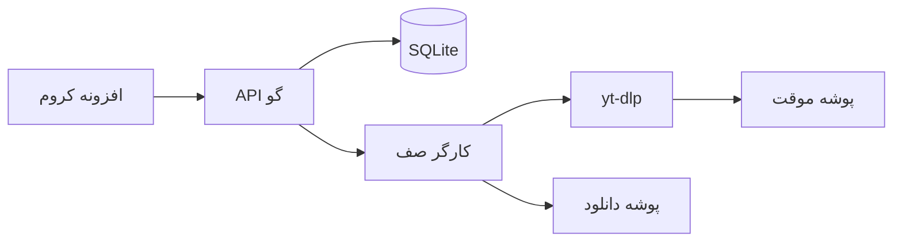
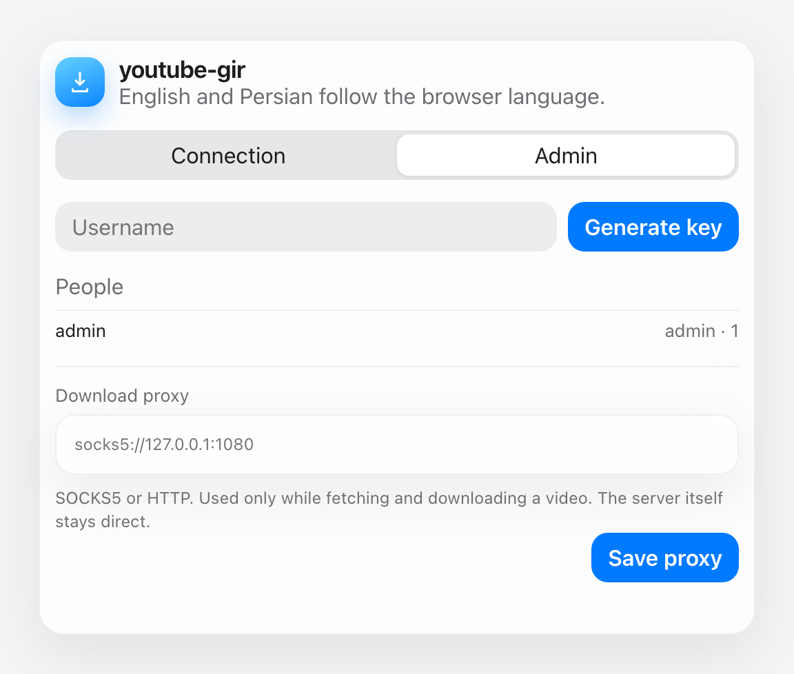
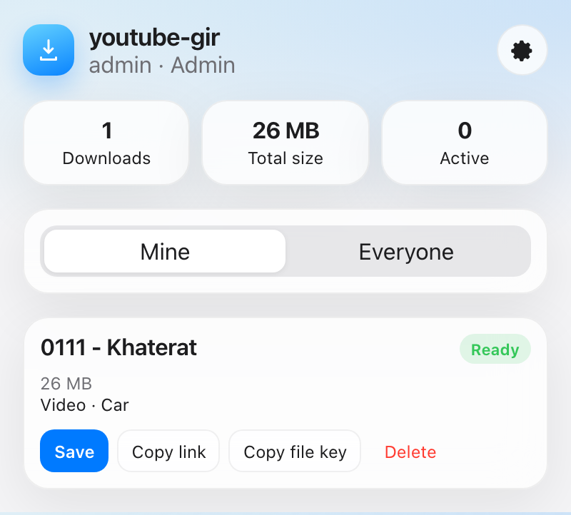
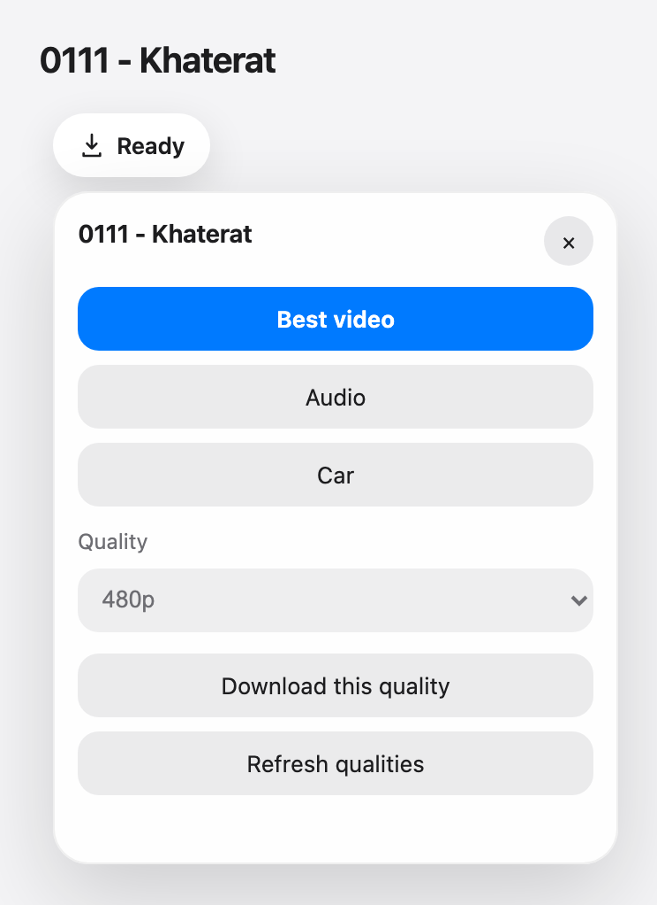

# youtube-gir

افزونهٔ کروم و یک سرور کوچک Go برای صف کردن دانلود ویدیو و صدای یوتیوب. افزونه روی صفحهٔ تماشا یک دکمه می‌گذارد. سرور با `yt-dlp` دانلود می‌کند، صف را در SQLite نگه می‌دارد، و برای هر فایل تمام‌شده یک لینک خصوصی می‌سازد.

ابزار خط فرمان قبلی همین مخزن هنوز سر جایش است. راهنمای آن [docs/cli.fa.md](docs/cli.fa.md) است. راهنمای انگلیسی سرور و افزونه [README.md](README.md) است.

مسئولیت حق دانلود رسانه‌ای که درخواست می‌کنید با شماست.

## معماری

افزونه خودش ویدیو را دانلود نمی‌کند. با سروری که شما اجرا می‌کنید حرف می‌زند؛ روی همین دستگاه یا روی یک ماشین دیگر. هر نفر یک کلید API دارد و فقط صف خودش را می‌بیند. کلید مدیر همهٔ کاربرها و همهٔ دانلودها را می‌بیند.

بایت‌های تمام‌شده به volume دانلودها کپی می‌شوند. فایل‌های ناقص `yt-dlp` روی volume موقت می‌مانند تا مکث، قطع شبکه، یا ری‌استارت سرور از همان نقطه ادامه پیدا کند.



## فازها

هر چهار فاز در همین مخزن پیاده شده‌اند.

**فاز ۱ — دانلود و صف.** API، کار ویدیو و صدا، گرفتن فرمت و حجم فایل، صف SQLite، و کارگری با سقف هم‌زمانی قابل تنظیم.

**فاز ۲ — رابط افزونه.** دکمهٔ Manifest V3 روی صفحهٔ تماشا و Shorts، انتخاب کیفیت، پنجرهٔ پیشرفت، ظاهر روشن و تیره به سبک اپل. متن‌ها انگلیسی و فارسی‌اند.

**فاز ۳ — مدیر و کلیدها.** کلید مدیر از روی نام کاربر یک کلید می‌سازد. کاربرها از هم جدا هستند. مدیر همه را می‌بیند. هر دانلود یک توکن فایل و یک نشانی مستقیم دارد.

**فاز ۴ — ادامه و اجرا.** پوشهٔ موقت جدا، قطع امن فرایند تا فایل‌های `.part` بمانند، برگرداندن کار نیمه‌کاره بعد از ری‌استارت، volumeهای داکر، سلامت سرویس، و به‌روزرسانی yt-dlp.

## اجرا با داکر

داکر دسکتاپ روی مک با Apple Silicon (از جمله سری M) ایمیج بومی `linux/arm64` می‌سازد. `linux/amd64` را تحمیل نکنید.

```bash
cp .env.example .env
openssl rand -hex 32
# مقدار را در ADMIN_KEY داخل .env بگذارید

docker compose up -d --build
docker compose ps
curl -s http://127.0.0.1:6543/health
```

کامپوز سه volume نام‌دار می‌سازد: `youtubegir-db` برای پایگاه داده، `youtubegir-downloads` برای فایل‌های آماده، و `youtubegir-tmp` برای فایل‌های ناقص. کانتینر مگر اینکه خودتان متوقفش کنید دوباره بالا می‌آید و در پس‌زمینه می‌ماند.

```bash
docker compose logs -f
docker compose stop
docker compose start
```

پورت منتشرشده همان `PORT` در `.env` است (پیش‌فرض `6543`).

## اجرای بومی

روی مک:

```bash
brew install go ffmpeg yt-dlp deno
export ADMIN_KEY="$(openssl rand -hex 32)"
export ADDR=127.0.0.1:6543
go run ./cmd/youtubegir
```

نسخه‌های تازهٔ `yt-dlp` برای اسکریپت پلیر یوتیوب به `deno` یا Node نیاز دارند. اگر `deno` در `PATH` باشد سرور خودش آن را انتخاب می‌کند. با `JS_RUNTIME=none` خاموشش کنید.

باینری و اجرای پس‌زمینه:

```bash
make build
export ADMIN_KEY="$(openssl rand -hex 32)"
export ADDR=127.0.0.1:6543
export DATA_DIR="$HOME/.youtubegir"
nohup dist/youtubegir >> "$HOME/Library/Logs/youtubegir.log" 2>&1 &
```

اگر `DATA_DIR` را نگذارید، داده‌ها در پوشهٔ `data` کنار مخزن می‌نشینند.

## نصب افزونه

1. `chrome://extensions` را باز کنید.
2. Developer mode را روشن کنید.
3. **Load unpacked** را بزنید و پوشهٔ `extension` همین مخزن را انتخاب کنید.
4. تنظیمات افزونه را باز کنید (کلیک راست روی آیکون، یا چرخ‌دنده داخل پنجره).
5. نشانی سرور برای همین مک: `http://127.0.0.1:6543`. برای هر میزبان دیگر، کروم هنگام ذخیره یا آزمایش اجازه می‌خواهد.
6. کلید API را بچسبانید. کلید در `chrome.storage.local` می‌ماند و با حساب گوگل همگام نمی‌شود.

روی صفحهٔ تماشای یوتیوب یا Shorts یک دکمهٔ **دانلود** در ردیف دکمه‌ها ظاهر می‌شود. اگر آن ردیف پیدا نشود، دکمه گوشهٔ صفحه می‌ایستد. کیفیت و حجم را می‌گیرد و ویدیو یا صدای M4A باکیفیت را به صف می‌فرستد. پنجرهٔ افزونه پیشرفت، حجم کل دانلودهای تمام‌شده، و دکمه‌های مکث، ادامه، لغو، ذخیره و حذف را نشان می‌دهد. عنوان فایل آماده، ویدیوی اصلی را باز می‌کند. تا وقتی پنجره باز است، تقریباً هر یک ثانیه وضعیت را می‌پرسد.







اگر زبان مرورگر فارسی باشد، رابط افزونه فارسی است. در غیر این صورت انگلیسی است. رشته‌ها در `extension/src/i18n.js` هستند.

## ساخت کلید کاربر

کلید مدیر همان `ADMIN_KEY` است و کلید API مدیر هم هست.

```bash
curl -s -X POST http://127.0.0.1:6543/api/v1/users \
  -H "Authorization: Bearer $ADMIN_KEY" \
  -H "Content-Type: application/json" \
  -d '{"username":"alice"}'
```

```json
{
  "id": 2,
  "username": "alice",
  "role": "user",
  "token": "…هگز ۶۴ بایتی…",
  "created_at": "2026-11-01T12:00:00Z"
}
```

`token` را به همان نفر بدهید. سرور آن را نگه می‌دارد، ولی فهرست بعدی کاربرها توکن را دوباره نشان نمی‌دهد. نام کاربر ۲ تا ۳۲ نویسه است: حرف، عدد، `_` و `-`. نام `admin` رزرو است.

مدیر از تنظیمات افزونه هم می‌تواند کلید بسازد. چرخ‌دنده را باز کنید، زبانهٔ **مدیر** را بزنید، نام را بنویسید و **ساخت کلید** را بزنید. کلید یک بار نشان داده و در کلیپ‌بورد کپی می‌شود.

## API

کلید را با `Authorization: Bearer <key>` یا `X-API-Key` بفرستید. خطاها این شکل را دارند: `{"error":"…","code":"…"}`.

| روش | مسیر | چه کسی | کار |
| --- | --- | --- | --- |
| GET | `/health` | همه | وضعیت فرایند، yt-dlp و ffmpeg |
| GET | `/api/v1/me` | کاربر | نام، نقش، آمار شخصی |
| GET | `/api/v1/stats?scope=all` | کاربر؛ `scope=all` فقط مدیر | تعداد و حجم تمام‌شده |
| POST | `/api/v1/formats` | کاربر | کیفیت‌ها و حجم. بدنه: `{"url":"…"}` |
| POST | `/api/v1/downloads` | کاربر | گذاشتن در صف |
| GET | `/api/v1/downloads?limit=100&scope=all` | کاربر؛ `scope=all` فقط مدیر | صف به‌همراه آمار |
| GET | `/api/v1/downloads/{id}` | صاحب یا مدیر | یک کار |
| POST | `/api/v1/downloads/{id}/pause` | صاحب یا مدیر | مکث؛ فایل موقت می‌ماند |
| POST | `/api/v1/downloads/{id}/resume` | صاحب یا مدیر | ادامهٔ کار متوقف یا ناموفق |
| POST | `/api/v1/downloads/{id}/cancel` | صاحب یا مدیر | لغو و پاک کردن فایل موقت |
| DELETE | `/api/v1/downloads/{id}` | صاحب یا مدیر | حذف کار و فایل |
| GET | `/api/v1/files/{file_token}` | هر کس که توکن را دارد | دریافت فایل آماده |
| POST | `/api/v1/users` | مدیر | ساخت کاربر. بدنه: `{"username":"alice"}` |
| GET | `/api/v1/users` | مدیر | کاربرها و تعداد دانلود، بدون توکن |
| DELETE | `/api/v1/users/{id}` | مدیر | حذف کاربر، ردیف‌ها و فایل‌هایش |
| GET | `/api/v1/system/ytdlp` | مدیر | نسخهٔ yt-dlp |
| POST | `/api/v1/system/ytdlp/update` | مدیر | اجرای `yt-dlp -U` |
| GET | `/api/v1/system/proxy` | مدیر | پروکسی دریافت و دانلود ویدیو |
| PUT | `/api/v1/system/proxy` | مدیر | تنظیم یا پاک کردن پروکسی. بدنه: `{"proxy":"socks5://127.0.0.1:1080"}` |

گذاشتن در صف:

```bash
curl -s -X POST http://127.0.0.1:6543/api/v1/downloads \
  -H "Authorization: Bearer $ALICE_TOKEN" \
  -H "Content-Type: application/json" \
  -d '{"url":"https://www.youtube.com/watch?v=VIDEO_ID","kind":"video","quality":"1080"}'
```

`kind` برابر `video` یا `audio` است. `quality` برای ویدیو یکی از این‌هاست: `best`، `car` (H.264 تا 1080p، صدای AAC با ۱۹۲ کیلوبیت و ۴۴٫۱ کیلوهرتز، فایل MP4)، یک ارتفاع استاندارد (`144`، `240`، `360`، `480`، `720`، `1080`، `1440`، `2160`، `4320`)، یا شناسهٔ فرمت yt-dlp مثل `137+140`. صدا همیشه بهترین صوت را به M4A تبدیل می‌کند. پارامتر پلی‌لیست نادیده گرفته می‌شود. اگر همان نشانی، نوع و کیفیت هنوز فعال باشد، همان کار با `"duplicate": true` برمی‌گردد.

پاسخ `202` شامل `download.file_token` است. این توکن کلید خصوصی فایل است:

```text
http://127.0.0.1:6543/api/v1/files/<file_token>
```

مسیر فایل کلید API نمی‌خواهد، چون دانلود مرورگر نمی‌تواند هدر بفرستد. این نشانی را مثل گذرواژه نگه دارید.

فقط نشانی ویدیوی `youtube.com`، `youtu.be`، `music.youtube.com` و `youtube-nocookie.com` پذیرفته می‌شود.

## ادامه بعد از قطع

هر کار یک پوشه زیر volume موقت دارد. هر بار yt-dlp با `--continue` و همان پوشه اجرا می‌شود. مکث و خاموشی `SIGINT` را به گروه فرایند می‌فرستند (ffmpeg هم متوقف می‌شود) و فایل‌های `.part` را پاک نمی‌کنند. اگر سرور ناگهان بمیرد، شروع بعدی ردیف‌های گیرکرده در `downloading` را به `queued` برمی‌گرداند و yt-dlp همان فایل ناقص را ادامه می‌دهد. `docker stop` خاموشی تمیز است. هنگام ادغام فایل از `kill -9` استفاده نکنید.

چون پوشهٔ موقت و پوشهٔ دانلود volumeهای جدا هستند، فایل آماده کپی می‌شود نه rename.

## تنظیمات

| متغیر | پیش‌فرض | معنی |
| --- | --- | --- |
| `ADMIN_KEY` | اجباری | کلید مدیر. دست‌کم ۳۲ نویسهٔ تصادفی |
| `ADDR` | `:6543` | نشانی شنود. `127.0.0.1:6543` فقط همین دستگاه |
| `DATA_DIR` | `data` | ریشهٔ پایگاه، دانلودها و فایل موقت |
| `DB_PATH` | `$DATA_DIR/db/youtubegir.sqlite` | فایل SQLite |
| `DOWNLOAD_DIR` | `$DATA_DIR/downloads` | فایل‌های آماده |
| `TEMP_DIR` | `$DATA_DIR/tmp` | فایل‌های ناقص برای ادامه |
| `MAX_CONCURRENT` | `2` | تعداد هم‌زمان yt-dlp، سقف ۳۲ |
| `YTDLP_PATH` | `yt-dlp` | مسیر باینری |
| `FFMPEG_PATH` | پیدا شدن در `PATH` | ادغام و استخراج صدا |
| `JS_RUNTIME` | `deno` یا `node` اگر باشد | به yt-dlp داده می‌شود. `none` خاموشش می‌کند |
| `COOKIES_FILE` | خالی | کوکی Netscape اختیاری برای ویدیوهایی که حسابتان باز می‌کند |
| `DOWNLOAD_PROXY` | خالی | پروکسی SOCKS یا HTTP برای اولین اجرا، مثل `socks5://127.0.0.1:1080`. بعد از ذخیره، تنظیم مدیر معتبر است |

ویدیوی محدودیت سنی یا مخصوص اعضا به فایل کوکی نیاز دارد که از مرورگری که در آن وارد شده‌اید گرفته شده باشد. آن را فقط-خواندنی mount کنید و `COOKIES_FILE` را بگذارید. این فایل را کامیت نکنید.

مدیر می‌تواند پروکسی دانلود را از زبانهٔ مدیر در تنظیمات افزونه بگذارد، یا با این درخواست:

```bash
curl -s -X PUT http://127.0.0.1:6543/api/v1/system/proxy \
  -H "Authorization: Bearer $ADMIN_KEY" \
  -H "Content-Type: application/json" \
  -d '{"proxy":"socks5://127.0.0.1:1080"}'
```

`--proxy` فقط وقتی به yt-dlp داده می‌شود که کیفیت را می‌خواند یا ویدیو را دانلود می‌کند. API، دریافت فایل، بررسی نسخه و `yt-dlp -U` مستقیم می‌مانند. `{"proxy":""}` پروکسی را پاک می‌کند. اگر نشانی گذرواژه داشته باشد، در فهرست فرایندهای سرور دیده می‌شود. `DOWNLOAD_PROXY` فقط وقتی در پایگاه کپی می‌شود که هنوز پروکسی ذخیره نشده باشد.

به‌روزرسانی yt-dlp:

```bash
curl -s -X POST http://127.0.0.1:6543/api/v1/system/ytdlp/update \
  -H "Authorization: Bearer $ADMIN_KEY"
```

در داکر باینری در `/usr/local/bin` است و `-U` تا ساخت دوبارهٔ کانتینر همان فایل را عوض می‌کند. برای برگشتن به زنجیرهٔ ابزار ایمیج، ایمیج را دوباره بسازید.

## امنیت

- کلید مدیر همهٔ دانلودها را می‌بیند و می‌تواند پاک کند. آن را در افزونه نگذارید مگر مرورگر خود مدیر باشد.
- توکن فایل قابل حدس زدن نیست و برای دانلود فایل آماده کافی است. آن را در گفتگوی عمومی نفرستید.
- سروری که روی `:6543` گوش می‌دهد از بقیهٔ دستگاه‌های شبکه هم دیده می‌شود. برای لپ‌تاپ `ADDR=127.0.0.1:6543` بگذارید. برای سرور دور، HTTPS را جلوتر بگذارید (Caddy یا nginx) و پورت خام را به اینترنت باز نکنید.
- ایمیج داکر با کاربر root اجرا می‌شود تا volumeهای نام‌دار قابل نوشتن بمانند. آن را به کسانی که نباید کلید داشته باشند نشان ندهید.

## توسعه

```bash
make test
make build
```

آزمون‌ها نشانی، تجزیه‌گر پیشرفت، صف (مکث فایل ناقص را نگه می‌دارد و لغو آن را پاک می‌کند)، جدابودن کاربرها، و دانلود با توکن فایل را می‌پوشانند. به یوتیوب وصل نمی‌شوند.

ظاهر افزونه در [design.md](design.md) نوشته شده است.

## ابزار خط فرمان

`install.sh` و `bin/youtube-gir` با باینری سرور فرق دارند. ابزار پوسته با نام‌های `youtube-gir` و `youtube-git` نصب می‌شود و راهنمایش [docs/cli.fa.md](docs/cli.fa.md) است. `make build` سرور API را در `dist/youtubegir` می‌سازد.
