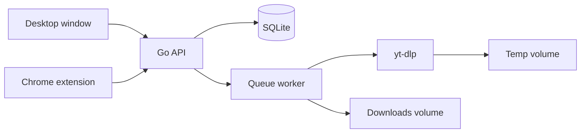
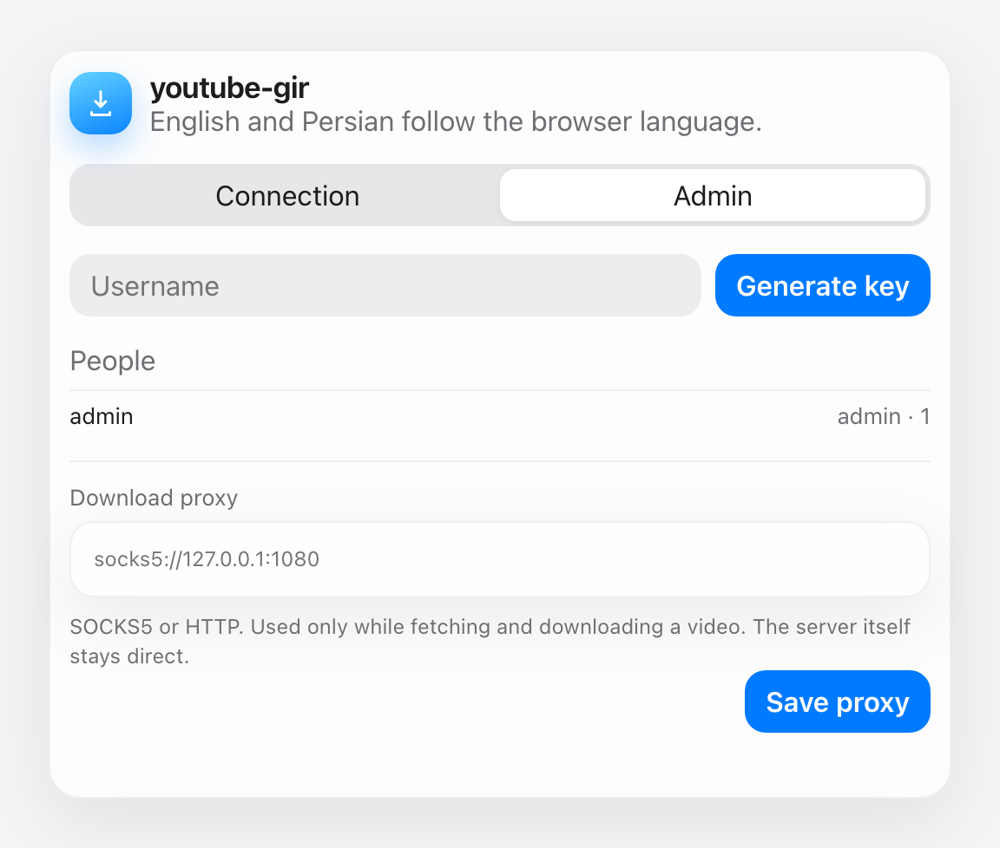
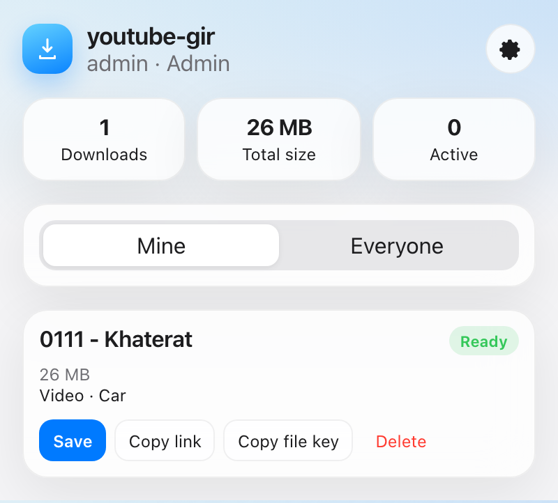
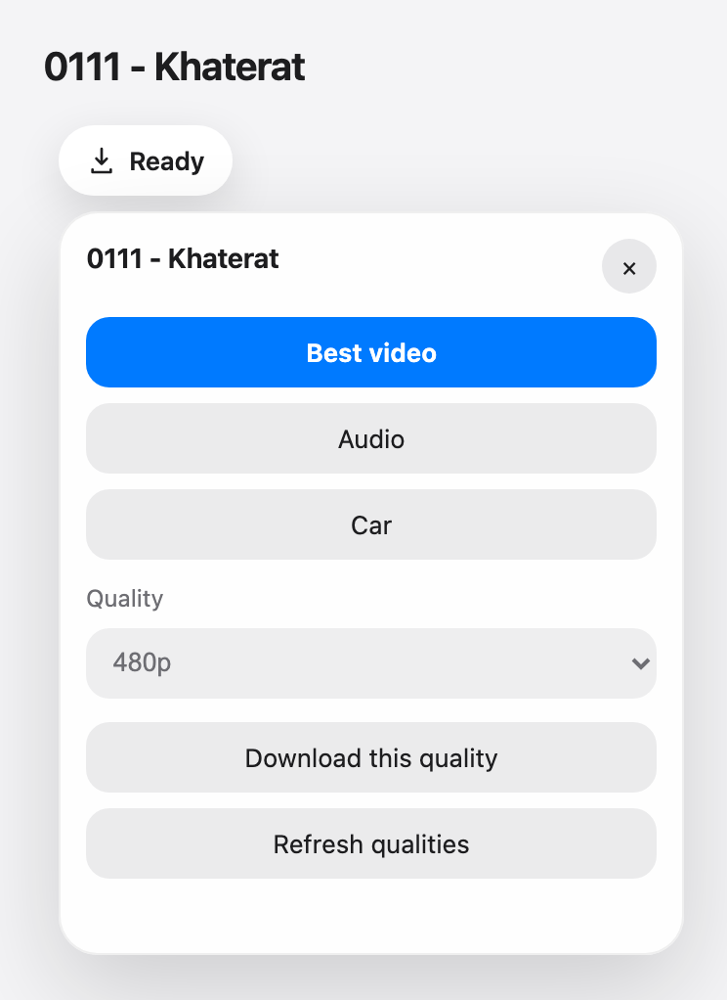

# youtube-gir

youtube-gir downloads YouTube video and audio with yt-dlp. There are three ways to use it: a desktop app that starts the server and opens a window, the original command-line tool, and a Chrome extension that talks to the server.

The desktop app includes the server and the downloader. You can also run that server on its own, including in Docker, and point the extension at it. The extension adds a download button on the watch page. The server keeps a queue in SQLite and hands each finished file a private link. The command-line guide is [docs/cli.fa.md](docs/cli.fa.md). Persian documentation is in [README.fa.md](README.fa.md).

You are responsible for having the rights to download the media you request.

## Architecture



The extension never downloads the video itself. It talks to the server you run, locally or on another machine. Each person has an API key. A person only sees their own queue. The admin key sees every user and every download.

Finished bytes are copied onto the downloads volume. Partial `yt-dlp` files stay on the temp volume, so a pause, a crash, or a dropped network can continue from the same place.

## Phases

All four phases below are in this tree.

**Phase 1 — Core download and queue.** REST API, video and audio jobs, format and file-size lookup, SQLite queue, and a worker with a configurable concurrency limit.

**Phase 2 — Extension UI.** Manifest V3 button on YouTube watch and Shorts pages, quality picker, popup dashboard with live progress, Apple-style light and dark UI. Strings are English and Persian.

**Phase 3 — Admin and keys.** The admin key creates a user key from a username. Users are isolated. Admins can list everyone. Each download gets a file token and a direct download URL.

**Phase 4 — Resume and operations.** Dedicated temp directory, interrupt handling that keeps `.part` files, requeue after a restart, Docker volumes, health checks, and a yt-dlp update endpoint.

## Downloads

A `v*` tag publishes a GitHub release with the server, the desktop app, and the extension. The file list and checksums are on the release.

| File | Machine |
| --- | --- |
| `youtube-gir-<tag>-darwin-arm64.app.zip` | Mac, Apple silicon. Unzip and move `youtube-gir.app` to Applications |
| `youtube-gir-<tag>-darwin-amd64.app.zip` | Mac, Intel. Unzip and move `youtube-gir.app` to Applications |
| `youtubegir-<tag>-darwin-arm64` | Mac, Apple silicon, server |
| `youtubegir-<tag>-darwin-amd64` | Mac, Intel, server |
| `youtubegir-<tag>-linux-amd64` | Linux, 64-bit, server |
| `youtubegir-<tag>-linux-arm64` | Linux, ARM 64-bit, server |
| `youtubegir-<tag>-windows-amd64.exe` | Windows, 64-bit, server |
| `youtubegir-gui-<tag>-darwin-arm64` | Mac, Apple silicon, terminal build of the desktop app |
| `youtubegir-gui-<tag>-darwin-amd64` | Mac, Intel, terminal build of the desktop app |
| `youtubegir-gui-<tag>-linux-amd64` | Linux, 64-bit, desktop app |
| `youtubegir-gui-<tag>-linux-arm64` | Linux, ARM 64-bit, desktop app |
| `youtubegir-gui-<tag>-windows-amd64.exe` | Windows, 64-bit, desktop app |
| `youtube-gir-extension-<tag>.zip` | Chrome extension |

https://github.com/WhoisGray/youtube-gir/releases

The server and the desktop app do not include yt-dlp, ffmpeg, or deno. Install those beside them.

```bash
chmod +x youtubegir-<tag>-darwin-arm64
export ADMIN_KEY="$(openssl rand -hex 32)"
export ADDR=127.0.0.1:6543
export DATA_DIR="$HOME/.youtubegir"
./youtubegir-<tag>-darwin-arm64
```

On Windows, set `ADMIN_KEY` and `ADDR`, then run the `.exe`. Unzip the extension, open `chrome://extensions`, turn on Developer mode, and choose **Load unpacked** on the unzipped folder.

macOS may block the binary the first time because it is not notarized. Allow it under Privacy and Security. Windows SmartScreen can show the same kind of prompt.

## Desktop app

`youtubegir-gui` starts the server and opens a window. Paste a YouTube link, then choose Best video, Audio, or Car. The queue, pause, resume, save, and delete controls match the extension.

Settings shows the server URL and API key so the extension can use this app. It also holds the download proxy and user keys.

On a Mac, download `youtube-gir-<tag>-darwin-arm64.app.zip` (Apple silicon) or `youtube-gir-<tag>-darwin-amd64.app.zip` (Intel). Unzip it. Move `youtube-gir.app` into Applications and double-click it. The first open can fail because the app is not notarized. Control-click the app, choose Open, then choose Open again. After that, a normal double-click works.

Data lives in `~/Library/Application Support/youtube-gir` unless `DATA_DIR` is set. On Linux it uses `$XDG_DATA_HOME/youtube-gir` or `~/.local/share/youtube-gir`. On Windows it uses `%AppData%\youtube-gir`. The app listens on `127.0.0.1:6543` when that port is free. If something else is already there, it picks the next free port and shows the URL in Settings. Close the window to stop the server. Clicking the icon again opens the window of the app that is already running.

The `youtubegir-gui-<tag>-darwin-*` file is the same program for a terminal:

```bash
chmod +x youtubegir-gui-<tag>-darwin-arm64
./youtubegir-gui-<tag>-darwin-arm64
```

`ADMIN_KEY`, `ADDR`, and `DATA_DIR` still override those defaults when you set them. `YG_GUI_NO_BROWSER=1` starts the server without a window.

Chrome, Edge, Chromium, or Brave opens the window. If none of those is installed, the app prints the URL and keeps serving until you stop it.

## Run with Docker

Docker Desktop on a Mac with Apple silicon builds a native `linux/arm64` image. Do not force `linux/amd64`.

```bash
cp .env.example .env
# put a long random value in ADMIN_KEY
openssl rand -hex 32

docker compose up -d --build
docker compose ps
curl -s http://127.0.0.1:6543/health
```

Compose stores the database, finished files, and partial files in three named volumes: `youtubegir-db`, `youtubegir-downloads`, and `youtubegir-tmp`. The container restarts unless you stop it, so it keeps running in the background.

```bash
docker compose logs -f
docker compose stop
docker compose start
```

The published port is `PORT` in `.env` (default `6543`).

## Run natively

On a Mac:

```bash
brew install go ffmpeg yt-dlp deno
export ADMIN_KEY="$(openssl rand -hex 32)"
export ADDR=127.0.0.1:6543
go run ./cmd/youtubegir
```

`deno` (or Node) lets current yt-dlp solve YouTube’s player script. The server picks `deno` automatically when it is on `PATH`. Set `JS_RUNTIME=none` to turn that off.

Build a binary and leave it running:

```bash
make build
export ADMIN_KEY="$(openssl rand -hex 32)"
export ADDR=127.0.0.1:6543
export DATA_DIR="$HOME/.youtubegir"
nohup dist/youtubegir >> "$HOME/Library/Logs/youtubegir.log" 2>&1 &
```

Data lands in `DATA_DIR` (`./data` in the repository when you do not set the variable).

## Install the extension

1. Open `chrome://extensions`.
2. Turn on Developer mode.
3. Choose **Load unpacked** and select the `extension` folder in this repository.
4. Open the extension’s options (right-click the icon, or the gear in the popup).
5. Server URL: `http://127.0.0.1:6543` for a server on this Mac. If you use the desktop app, copy the URL and API key from its Settings. For any other host, Chrome asks for permission when you save or test.
6. Paste an API key. Keys are stored with `chrome.storage.local` and are not synced to a Google account.

On a YouTube watch page or Short, a **Download** pill appears in the action row (or at the corner if YouTube’s layout has no row). It loads qualities and sizes, then queues a video or a high-quality M4A audio file. The popup shows progress, total completed size, and actions to pause, resume, cancel, save, or delete. A finished title opens the original video. The popup polls the server about once a second while it is open.







If the browser language is Persian, the extension UI is Persian. Otherwise it is English. The rules live in `extension/src/i18n.js`.

## Generate a user key

The admin key is `ADMIN_KEY`. It is also the admin API key.

```bash
curl -s -X POST http://127.0.0.1:6543/api/v1/users \
  -H "Authorization: Bearer $ADMIN_KEY" \
  -H "Content-Type: application/json" \
  -d '{"username":"alice"}'
```

```json
{
  "id": 2,
  "username": "alice",
  "role": "user",
  "token": "…64-byte hex…",
  "created_at": "2026-11-01T12:00:00Z"
}
```

Give `token` to that person. The server stores it, but later user-list calls do not repeat it. Usernames are 2–32 characters: letters, numbers, `_`, and `-`. `admin` is reserved.

An admin can do the same from the extension settings. Open the gear, choose **Admin**, type a username, and press **Generate key**. The new key is shown once and copied to the clipboard.

## API

Send the key as `Authorization: Bearer <key>` or `X-API-Key`. Responses are JSON. Errors look like `{"error":"…","code":"…"}`.

| Method | Path | Who | Purpose |
| --- | --- | --- | --- |
| GET | `/health` | anyone | Process, yt-dlp, and ffmpeg status |
| GET | `/api/v1/me` | user | Name, role, personal stats |
| GET | `/api/v1/stats?scope=all` | user; `scope=all` is admin | Counts and completed bytes |
| POST | `/api/v1/formats` | user | Qualities and file sizes. Body: `{"url":"…"}` |
| POST | `/api/v1/downloads` | user | Queue a job. See below |
| GET | `/api/v1/downloads?limit=100&scope=all` | user; `scope=all` is admin | Queue plus stats |
| GET | `/api/v1/downloads/{id}` | owner or admin | One job |
| POST | `/api/v1/downloads/{id}/pause` | owner or admin | Pause. Keeps temp files |
| POST | `/api/v1/downloads/{id}/resume` | owner or admin | Queue a paused or failed job again |
| POST | `/api/v1/downloads/{id}/cancel` | owner or admin | Cancel and delete temp files |
| DELETE | `/api/v1/downloads/{id}` | owner or admin | Delete the job and its file |
| GET | `/api/v1/files/{file_token}` | anyone with the token | Download the finished file |
| POST | `/api/v1/users` | admin | Create a user. Body: `{"username":"alice"}` |
| GET | `/api/v1/users` | admin | Users and download counts. No tokens |
| DELETE | `/api/v1/users/{id}` | admin | Delete a user, their rows, and their files |
| GET | `/api/v1/system/ytdlp` | admin | yt-dlp version |
| POST | `/api/v1/system/ytdlp/update` | admin | Run `yt-dlp -U` |
| GET | `/api/v1/system/proxy` | admin | Proxy used for video fetches and downloads |
| PUT | `/api/v1/system/proxy` | admin | Set or clear that proxy. Body: `{"proxy":"socks5://127.0.0.1:1080"}` |

Queue a download:

```bash
curl -s -X POST http://127.0.0.1:6543/api/v1/downloads \
  -H "Authorization: Bearer $ALICE_TOKEN" \
  -H "Content-Type: application/json" \
  -d '{"url":"https://www.youtube.com/watch?v=VIDEO_ID","kind":"video","quality":"1080"}'
```

`kind` is `video` or `audio`. `quality` for video is `best`, `car` (H.264 up to 1080p, AAC 192 kbps, 44.1 kHz, MP4), a standard height (`144`, `240`, `360`, `480`, `720`, `1080`, `1440`, `2160`, `4320`), or a yt-dlp format id such as `137+140`. Audio always takes the best audio and writes M4A. Playlist parameters are ignored. The same active URL, kind, and quality returns the existing job with `"duplicate": true`.

The `202` body includes `download.file_token`. That token is the file’s private key:

```text
http://127.0.0.1:6543/api/v1/files/<file_token>
```

The file route does not use the API key, because browser downloads cannot set one. Treat the URL like a password.

Only `youtube.com`, `youtu.be`, `music.youtube.com`, and `youtube-nocookie.com` video URLs are accepted.

## Resume

Each job gets a directory under the temp volume. yt-dlp is started with `--continue` and that same directory on every attempt. Pause and shutdown send `SIGINT` to the process group (so ffmpeg stops too) and leave `.part` files in place. A hard kill of the server is repaired on the next start: rows stuck in `downloading` go back to `queued`, and yt-dlp continues those partial files. `docker stop` is a clean shutdown. Avoid `kill -9` while a merge is in progress.

The temp volume and the downloads volume are separate, so the server copies the finished file instead of renaming across mounts.

## Configuration

| Variable | Default | Meaning |
| --- | --- | --- |
| `ADMIN_KEY` | required | Admin API key. Use at least 32 random characters |
| `ADDR` | `:6543` | Listen address. `127.0.0.1:6543` keeps it on this machine |
| `DATA_DIR` | `data` | Root for the database, downloads, and temp files |
| `DB_PATH` | `$DATA_DIR/db/youtubegir.sqlite` | SQLite file |
| `DOWNLOAD_DIR` | `$DATA_DIR/downloads` | Finished files |
| `TEMP_DIR` | `$DATA_DIR/tmp` | Partial files used for resume |
| `MAX_CONCURRENT` | `2` | Parallel yt-dlp processes, capped at 32 |
| `YTDLP_PATH` | `yt-dlp` | Binary |
| `FFMPEG_PATH` | discovered on `PATH` | Used for merging and audio extract |
| `JS_RUNTIME` | `deno` or `node` if found | Passed to yt-dlp. `none` disables it |
| `COOKIES_FILE` | empty | Optional Netscape cookies for videos your account can open |
| `DOWNLOAD_PROXY` | empty | First-run SOCKS or HTTP proxy, for example `socks5://127.0.0.1:1080`. After a proxy is saved, the admin setting wins |

Age-restricted or member videos need a cookies file exported from a browser where you are signed in. Mount it read-only and set `COOKIES_FILE`. Do not commit that file.

An admin can set a download proxy from the extension settings, on the Admin tab, or with:

```bash
curl -s -X PUT http://127.0.0.1:6543/api/v1/system/proxy \
  -H "Authorization: Bearer $ADMIN_KEY" \
  -H "Content-Type: application/json" \
  -d '{"proxy":"socks5://127.0.0.1:1080"}'
```

yt-dlp receives `--proxy` only while it reads formats or downloads a video. The API, file downloads, version check, and `yt-dlp -U` stay direct. Send `{"proxy":""}` to clear it. A URL that contains a password is visible in the process list on the server. `DOWNLOAD_PROXY` is copied into the database only when no proxy has been saved yet.

Update yt-dlp from the admin key:

```bash
curl -s -X POST http://127.0.0.1:6543/api/v1/system/ytdlp/update \
  -H "Authorization: Bearer $ADMIN_KEY"
```

In Docker the binary lives in `/usr/local/bin`, so `-U` can replace it until the container is recreated. Rebuild the image when you want a pinned toolchain again.

## Security

- The admin key can see and delete every download. Keep it out of the extension unless that browser is the admin’s.
- File tokens are unguessable and are enough to download a finished file. Do not paste them into a public chat.
- A server on `:6543` is reachable from other machines on the network. For a laptop, set `ADDR=127.0.0.1:6543`. For a remote server, put HTTPS in front of it (Caddy or nginx) and do not publish the raw port to the internet.
- The Docker image runs as root so the named volumes stay writable. Do not expose it beyond the people who should have keys.

## Development

```bash
make test
make build
make gui
```

Tests cover URL checks, the progress parser, the queue (pause keeps the partial file, cancel removes it), user isolation, and the file token download. They do not call YouTube.

The visual system for the extension is written down in [design.md](design.md).

## Command-line tool

`install.sh`, `bin/youtube-gir`, the desktop app, and `make`’s server binary are different programs. The shell tool installs as `youtube-gir` / `youtube-git` and is documented in [docs/cli.fa.md](docs/cli.fa.md). `make build` writes `dist/youtubegir` and `dist/youtubegir-gui`. `make gui` runs the desktop app.
